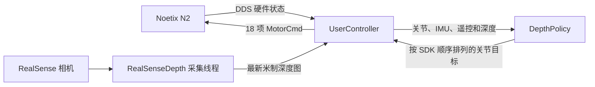

# Noetix N2 深度步态部署代码说明

`nano_perc_5propri_5depth` 分支的深度步态入口是 `examples/py/test_policy.py`。部署主机接收机器人状态和 RealSense 深度图，用 `policy/n2_depth.onnx` 计算 18 个关节的位置目标，再通过当前 N2 SDK 发送命令。仓库也提供高层遥控、固定关节指令和使用 `policy_user.onnx` 的 C++ 步态示例。

## 目录和入口

| 文件或目录 | 功能 |
| --- | --- |
| `README.md` | 平台、依赖和深度步态运行命令。 |
| `build.sh`、`CMakeLists.txt` | 选择当前架构的 SDK 与 DDS 库，构建 C++ 示例和 Python 扩展。 |
| `examples/py/test_policy.py` | 实机深度步态入口。初始化 DDS、RealSense 和策略，运行控制循环。 |
| `examples/py/user_controller.py` | 实机和仿真共用的状态回调、遥控模式切换、推理降频和关节命令。 |
| `examples/py/depth_policy.py` | 加载 ONNX 和模型参数，组装三路历史输入，执行推理并映射关节顺序。 |
| `examples/py/depth_camera.py` | 两种深度源共用的像素射线和带时间戳的最近帧缓存。 |
| `examples/py/realsense_depth.py` | 独立线程采集深度，按相机内参重采样，向控制循环提供最新的米制深度。 |
| `examples/py/sim2sim.py`、`sim_remote.py` | MuJoCo 启动入口、模拟传感器和电机，以及 Linux 手柄输入适配。 |
| `simulation/`、`requirements-sim.txt` | 仿真专用的 MJCF、网格和 Python 依赖。 |
| `examples/py/test_high.py`、`test_low.py` | 分别演示高层遥控和固定关节指令。`test_low.py` 会向机器人发送一组预设位置和增益。 |
| `examples/py/*.pyi` | 为 IDE 和类型检查工具描述 Python SDK 接口。 |
| `examples/cpp/` | `example_high.cpp` 演示高层遥控。`example_low.cpp` 演示仅使用关节和 IMU 的 C++ 步态。 |
| `config/` | DDS 网络 XML 和 C++ 步态参数 `ning_user.yaml`。 |
| `policy/` | 深度策略 `n2_depth.onnx` 与 C++ 步态策略 `policy_user.onnx`。 |
| `include/` | 控制器接口、硬件状态和命令结构、遥控器接口以及旋转计算。 |
| `pybind/` | 导出 Python 可用的 C++ SDK 接口。 |
| `lib/{aarch64,x86_64}/` | 两套预编译 `libnoetix_n2_sdk.a`，提供控制器和驱动实现。 |
| `dds/{aarch64,x86_64}/` | 对应架构的 Cyclone DDS 头文件、共享库和工具。`idlc` 用于 IDL 代码生成，`ddsperf` 用于通信测试。 |

## 深度步态数据流



### 启动和控制循环

`main()` 从仓库根目录的 `build/` 导入 `lowcontrol_py`，加载深度 ONNX，再启动相机并初始化 `LowController`。`UserController.on_status()` 接收 `RobotHardwareStatus`，将状态和接收时间一起保存。实机使用单调时钟，仿真使用模拟时钟。`process()` 使用该状态处理遥控、选择模式并发送关节命令。主循环的目标周期是 `2 ms`，模型周期是 `20 ms`，因此每 10 个控制周期执行一次推理。两次推理之间复用上一组目标。对应的名义频率为控制 `500 Hz`、推理 `50 Hz`。[Python 部署入口](../examples/py/test_policy.py) · [共用控制器](../examples/py/user_controller.py)

| 模式 | 代码行为 |
| --- | --- |
| `DEFAULT` | 初始模式。状态回调开始提供数据后，默认模式发送 `kp = 0`、`kd = 0.1` 的低阻尼命令。 |
| `LIE` | 从进入模式时的位置起，用约 2 秒过渡到全零目标角。 |
| `STAND` | 用约 2 秒过渡到模型元数据给出的默认关节角。站立和趴下过渡采用 `UserController` 中定义的 `pose_kp` 和 `pose_kd`。 |
| `USERWALK` | 进入时清零上一动作和速度历史。`handle_walk_mode()` 周期性执行策略并使用模型元数据中的增益下发关节目标。 |

按键 `9` 在默认模式与受控模式之间切换，启用后先进入 `LIE`。`10 + 2` 从趴下或步态切到站立。站立过渡完成且有新鲜深度帧时，`5 + 2` 启动步态。步态中按 `11` 回到站立，在默认模式按 `11` 可进入趴下。纵向指令取自 `axes[1]`，偏航取自 `axes[0]`，横向置零。模型限制前向速度指令在 `0–1 m/s`、偏航角速度指令在 `−0.6–0.6 rad/s`。

状态超过 `0.2 s` 未更新或关节位置出现非有限值时，控制器进入 `DEFAULT`。步态中深度超过 `0.2 s` 未更新时进入 `STAND`，策略发现观测或输出异常并抛出 `ValueError` 时也进入 `STAND`。实机处理 `Ctrl+C` 退出时，如果已经收到硬件状态，程序会下发一次默认模式命令并关闭相机。[模式与超时处理](../examples/py/user_controller.py)

实机和 MuJoCo 都在每个控制周期检查 IMU。机身 Z 轴偏离竖直超过 `45°`，或 IMU 四元数无效时，控制器立即进入 `DEFAULT`，关节只保留 `kd = 0.1` 的低阻尼。扶正后松开并重新按启动键，恢复趴下、站立和步态的操作流程。[摔倒保护](../examples/py/user_controller.py)

### 相机线程和深度预处理

1. `RealSenseDepth.__enter__()` 开启 `640×480` 的 Z16 深度流，默认 `90 fps`，可用 `--camera-fps` 调整。它读取当前深度流的内参，并根据 ONNX 元数据中的目标内参，为 `16×24` 目标图像预计算像素索引。
2. `capture()` 在独立线程中等待相机帧，使用预计算索引进行最近邻取样，再乘以 RealSense 的深度单位，把 Z16 值转成米。采样映射到相机视野外时填零。线程以时间戳和图像一起发布最新帧。
3. `latest_frame()` 供控制循环读取已有帧。`DepthPolicy` 在每次推理时将这张图写入历史缓冲。模型图内处理非有限值和 `0.3–2.0 m` 有效范围外的深度值，并执行深度偏移。

相机软件映射使用内参，安装位置和朝向需要与模型元数据中的 `camera.position_base`、`camera.quaternion_wxyz` 对应。模型使用沿相机光轴的深度，图像维度按高 `16`、宽 `24` 排列。[RealSense 接入源码](../examples/py/realsense_depth.py) · [包含相机参数的 ONNX](../policy/n2_depth.onnx)

### ONNX 输入输出和历史窗口

`DepthPolicy.__init__()` 用 ONNX Runtime 的 CPU 执行后端加载模型，从 `ame_n2_depth` 元数据读取张量维度、相机参数、观测缩放、命令范围、关节默认值、动作缩放和 PD 增益。以下张量均为 `float32`，第一维为批大小。[策略实现](../examples/py/depth_policy.py)

| 张量 | 方向 | 形状 | 含义 |
| --- | --- | --- | --- |
| `proprio` | 输入 | `[1, 5, 63]` | 最近 5 个策略步的本体观测，按时间从旧到新排列。 |
| `depth_m` | 输入 | `[1, 5, 16, 24]` | 5 张米制深度图。每隔 3 个策略步取一个样本，步偏移依次是 `−12、−9、−6、−3、0`。在 50 Hz 下，样本相隔 `60 ms`。 |
| `velocity_history` | 输入 | `[1, 4, 3]` | 前 4 个策略步的机身坐标系线速度估计，每步包含 `vx`、`vy`、`vz`，单位为 `m/s`。 |
| `actions` | 输出 | `[1, 18]` | 模型关节顺序下的动作。 |
| `velocity` | 输出 | `[1, 3]` | 当前机身速度估计，写入历史供后续推理使用。 |

每步 63 项本体观测依次为机身角速度 `3`、机身坐标系下的投影重力 `3`、速度指令 `3`、相对默认位置的关节角 `18`、相对默认速度的关节速度 `18`、上一步动作 `18`。`projected_gravity()` 将 IMU 的 `xyzw` 四元数归一化并换算为重力方向。关节速度与机身角速度分别按模型参数缩放。重新进入步态时，第一步观测和第一帧深度用于填满各自的缓冲，历史速度初始为零。[观测组装和推理](../examples/py/depth_policy.py)

深度缓冲保存最近 13 个策略步采样的图像，并以步长 `3` 取 5 张送进模型。SDK 电机顺序为左臂 `0–3`、左腿 `4–8`、右臂 `9–12`、右腿 `13–17`。`to_model` 按模型的关节名重排实测数据。推理后按 `目标角 = 默认角 + action_scale × 动作` 得到位置目标，再用 `to_sdk` 转回 SDK 顺序。`send_targets()` 为每个电机写入位置目标和 `kp`、`kd`，速度目标和前馈力矩保持初始化时的零值。[关节映射](../examples/py/depth_policy.py) · [关节下发](../examples/py/user_controller.py)

## SDK 接口和网络配置

| 接口或文件 | 功能 |
| --- | --- |
| `include/lowcontroller.h` | 定义 `LowController::set_joint()` 和硬件状态订阅。每次下发 18 项 `MotorCmd`。 |
| `include/highcontroller.h` | 定义 `HighController::publish_cmd()` 和硬件状态订阅。高层示例向机器人发送纵向、横向和偏航命令及 `ControlCmd` 动作，例如行走、切换模式和示教。 |
| `include/common.h` | 定义 `RobotHardwareStatus`、`MotorState`、`MotorCmd`、`NingImuData`、`joydata` 和共用枚举。回调状态包含 IMU、遥控器、18 个电机及机器人上报模式。 |
| `include/Types.h`、`RotationTools.h` | 为 C++ 示例提供 Eigen 类型别名和姿态转换。 |
| `include/aolion_driver.h`、`serial_driver.h` | 声明本地遥控器驱动。深度入口使用 DDS 状态中的遥控器数据。 |
| `pybind/*_pybind.cpp` | 将两个控制器和 SDK 数据结构绑定到 Python。低层绑定检查 `MotorCmd` 数量，并在初始化等待 DDS 对端时释放 Python GIL，让相机线程仍能处理帧。 |

深度入口默认将 `CYCLONEDDS_URI` 指向 `config/dds.xml`，并接受启动前设置的环境变量。默认 XML 指定部署主机使用地址为 `192.168.55.101` 的网卡，将机器人地址 `192.168.55.102` 配置为静态发现对端，使用 UDP 并关闭组播。`dds_local.xml` 使用 `127.0.0.1`，用于回环通信。[机器人网络](../config/dds.xml) · [回环配置](../config/dds_local.xml) · [低层 Python 绑定](../pybind/lowcontrol_pybind.cpp)

## C++ 步态示例和 YAML

`examples/cpp/example_low.cpp` 加载 `policy_user.onnx` 与 `ning_user.yaml` 的 `user` 段。`updateStateEstimation()` 读取腿部关节和 IMU，`computeObservation()` 将每步 40 项观测叠成 5 步历史，`computeActions()` 从 `[1, 200]` 输入得到 `[1, 10]` 的腿部动作。`handleWalkMode()` 依照 YAML 中的动作缩放、默认角和关节增益构造电机命令，手臂目标单独计算。`ning_user.yaml` 中的 `decimation: 5` 用于此 C++ 控制循环。Python 深度步态的观测、关节参数和推理周期取自 `n2_depth.onnx` 的元数据。[C++ 低层示例](../examples/cpp/example_low.cpp) · [C++ 步态配置](../config/ning_user.yaml) · [C++ 步态模型](../policy/policy_user.onnx)

## 构建和启动

在仓库根目录使用同一个 Python 环境安装依赖、构建扩展并运行深度入口。

```bash
python -m pip install numpy onnxruntime pyrealsense2
CC=gcc-11 CXX=g++-11 cmake -S . -B build -DBUILD_CPP_EXAMPLES=OFF \
  -DPYBIND11_FINDPYTHON=ON -DPython_EXECUTABLE="$(command -v python)"
cmake --build build --target lowcontrol_py -j
python examples/py/test_policy.py
```

`BUILD_CPP_EXAMPLES=OFF` 在构建 Python 扩展时跳过 C++ 示例。若构建 C++ 示例，将选项设为 `ON`，CMake 会同时查找 C++ ONNX Runtime 包，低层示例还会链接 `yaml-cpp`。Jetson 的 RealSense Python 包与 JetPack 及 Python 版本有关，项目 README 列出了安装参考。[构建配置](../CMakeLists.txt) · [项目 README](../README.md)

## MuJoCo 仿真与手柄

在仿真用的 Python 环境安装依赖，从仓库根目录运行。默认读取 `/dev/input/js0`，也可以通过 `--joystick-device` 指定设备。仿真使用独立的 Python 依赖清单，C++ 示例沿用原构建入口。[仿真依赖](../requirements-sim.txt) · [仿真入口](../examples/py/sim2sim.py)

```bash
python -m pip install -r requirements-sim.txt
python examples/py/sim2sim.py --joystick
python examples/py/sim2sim.py --joystick --terrain stairs --step-height 0.10
```

MuJoCo 使用 `him_n2_sim` 的 N2 模型和网格。模拟 IMU、关节位置和速度进入同一个 `UserController`，电机适配层把共用的 `MotorCmd` 转成受 MJCF 力矩范围约束的 PD 力矩。深度相机根据 ONNX 里的内外参对地形投射射线，输出光轴方向的米制深度，按模型相机周期约 `60 Hz` 更新。控制循环仍按 `50 Hz` 采样深度历史。[N2 模型](../simulation/mjcf/N2.xml) · [仿真适配层](../examples/py/sim2sim.py) · [MuJoCo 射线接口](https://mujoco.readthedocs.io/en/latest/APIreference/APIfunctions.html#ray-casting)

MuJoCo 窗口默认在地形上显示深度命中点。进入步态后，点位来自最近一次推理输入的最新深度帧，点的颜色从蓝到红、大小从小到大，对应当前帧从低到高的空间注意力。进入步态前显示蓝色深度点。只有 `0.3–2.0 m` 内的有效深度参与绘制。窗口使用同一训练检查点导出的 `n2_depth_attention.onnx`，加 `--no-vis-attention` 可隐藏点位。[注意力模型](../policy/n2_depth_attention.onnx) · [绘制代码](../examples/py/sim2sim.py) · [MuJoCo 自定义绘制](https://mujoco.readthedocs.io/en/stable/python.html#passive-viewer)

| 手柄动作 | MuJoCo 的 Linux 物理键 | 实机 DDS 逻辑键 |
| --- | --- | --- |
| 启动或停止 | `7` | `9` |
| 站立 | `4 + 6` | `2 + 10` |
| 启动深度步态 | `4 + 2` | `2 + 5` |
| 从步态回到站立 | `11` | `11` |

仿真默认使用物理轴 `1` 的反向控制前进，物理轴 `3` 的反向控制转向。用 `--joystick-debug` 查看设备上报的编号，`--joystick-button-map 11=1` 可将实机逻辑键 `11` 映射到该手柄的物理键 `1`。轴编号和方向可用 `--joystick-forward-axis`、`--joystick-yaw-axis`、`--joystick-forward-sign` 和 `--joystick-yaw-sign` 调整。[手柄适配](../examples/py/sim_remote.py) · [Linux joydev 事件接口](https://www.kernel.org/doc/html/v4.14/input/joydev/joystick-api.html)

仿真启动时固定机身，允许用手柄完成趴下和站立过渡，首次进入 `USERWALK` 时自动释放。在 MuJoCo 窗口按 `R` 可重置机身和模式。默认场景沿前进方向依次布置 10 级上行台阶、顶部 `0.8 m` 的水平平台和 `20°` 下坡，整段路线宽 `1.6 m`。用 `--terrain flat` 可选择平地。

无窗口检查使用脚本输入触发同样的控制器状态转换。自动测试把 Linux 摇杆事件送进 MuJoCo，核对控制降频、深度几何以及 RealSense 适配层的单位换算。

```bash
python examples/py/sim2sim.py --headless --no-joystick --duration 6 --vx 0.25
python -m unittest discover -s tests -v
```
